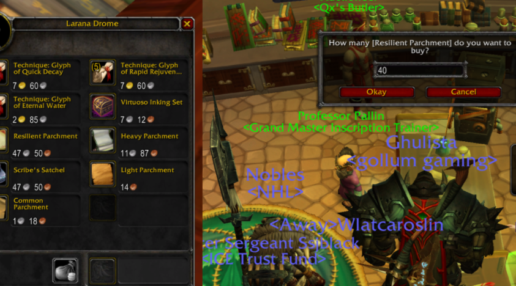

# BulkBuy

> World of Warcraft **3.3.5a (WotLK)** addon · made by **feralpaw**

Shift-click a vendor item, type any amount, and BulkBuy buys it stack by stack for you – no more clicking 20 times for 400 reagents.

## Usage
1. Open a vendor.
2. **Shift-click** the item.
3. Enter the amount you want.

## Installation
1. Download the latest ZIP from **Releases** (or *Code → Download ZIP*).
2. Copy `BulkBuy` into `World of Warcraft/Interface/AddOns/`.
   The folder name must stay exactly like this (no `-main` suffix).
3. Restart the game or type `/reload`.

## License
MIT – see [LICENSE](LICENSE).
